# Architecture de Chess Platform

> Sprint 21 — diagrammes UML (composants, modules, classes, séquences, états, déploiement).
> Les diagrammes sont écrits en [Mermaid](https://mermaid.js.org) : GitHub, GitLab et la plupart des éditeurs Markdown les affichent directement.

Documents liés : [base de données](database.md) · [API REST](api-rest-spec.md) · [événements WebSocket](websocket-events.md) · [déploiement](deployment.md) · [tests](testing.md) · [guide utilisateur](user-guide.md).

---

## 1. Vue d'ensemble

Chess Platform est un **monorepo** de trois applications :

| Application | Technologie | Rôle |
|---|---|---|
| `apps/client` | Flutter 3 (Riverpod) | Interface : Web, Android, iOS, Windows, macOS, Linux |
| `apps/api` | NestJS 10, Prisma, Socket.IO | Autorité de jeu : comptes, règles, pendule, parties en ligne, Elo, notifications |
| `apps/ai-engine` | NestJS 10, Stockfish (UCI) | Coups de l'IA niveau 5 et analyse des parties terminées |

Principe directeur : **le serveur est l'unique autorité**. Chaque coup est revalidé par `chess.js` côté API, la pendule des parties en ligne est mesurée par le serveur, et seul le joueur concerné peut jouer, abandonner ou accepter une nulle.

### 1.1 Diagramme de composants

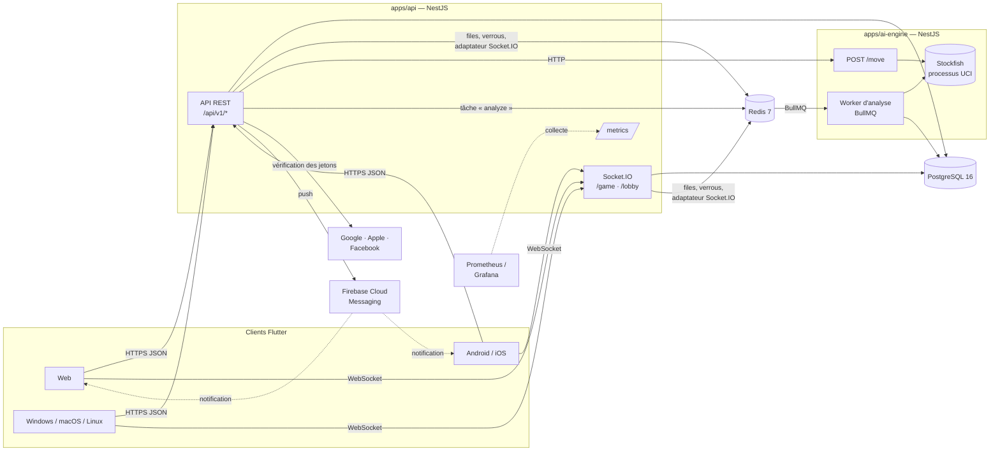

### 1.2 Rôle de Redis

| Usage | Clés / canaux | Module |
|---|---|---|
| File de matchmaking | `mm:queue:<cadence>` (ensemble trié par Elo), `mm:data:<userId>` (hachage, 5 min) | `MatchmakingService` |
| Verrous d'appariement | `mm:lock:player:<userId>` (10 s, jeton) | `MatchmakingService` |
| Propositions de nulle | `chess:draw-offer:<gameId>` (2 h) | `RedisDrawOfferStore` |
| Diffusion Socket.IO entre pods | canaux `chess-socket.io#…` | `RedisIoAdapter` |
| Tâches d'analyse | `bull:analysis:*` | BullMQ (`AnalysisService` → worker de l'IA) |

Aucune donnée durable n'est dans Redis : sa perte vide la file d'attente et les propositions de nulle en cours, rien d'autre.

---

## 2. API NestJS

### 2.1 Modules

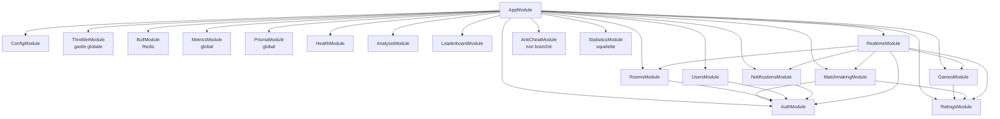

| Module | Contenu principal |
|---|---|
| `AuthModule` | inscription, connexion, rotation des refresh tokens, OAuth (Google, Apple, Facebook), stratégie JWT |
| `GamesModule` | `GamesService` (création, coups, pendule, fin de partie), `ChessEngineService` (chess.js), `AiEngineService` (IA niveaux 1-4), `StockfishClientService` (niveau 5), stockage des propositions de nulle |
| `RealtimeModule` | `GameGateway` (`/game`) et `LobbyGateway` (`/lobby`), limitation de débit des coups |
| `MatchmakingModule` | file Redis, appariement par Elo, verrous par joueur |
| `RoomsModule` | salles privées à code de 6 caractères |
| `RatingsModule` | Elo par cadence (K = 40 / 20 / 10), statistiques de fin de partie |
| `AnalysisModule` | envoi des tâches d'analyse, lecture des résultats |
| `NotificationsModule` | notifications en base, appareils push, envoi FCM |
| `MetricsModule` | registre Prometheus, mesure HTTP, `GET /metrics` |
| `AntiCheatModule` | heuristiques de temps de réflexion — **écrites mais appelées nulle part** |
| `StatisticsModule` | squelette vide (les statistiques sont calculées par `RatingsService`) |

### 2.2 Chaîne de traitement d'une requête HTTP

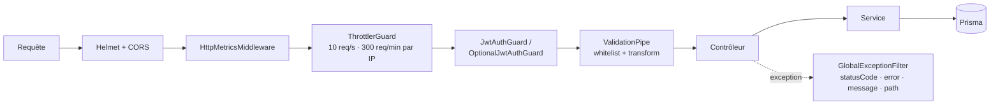

La configuration (préfixe `/api/v1`, Helmet, CORS, validation, filtre, adaptateur Redis) est centralisée dans `src/app.setup.ts` et partagée par `main.ts` et les tests end-to-end.

### 2.3 Diagramme de classes — domaine de jeu

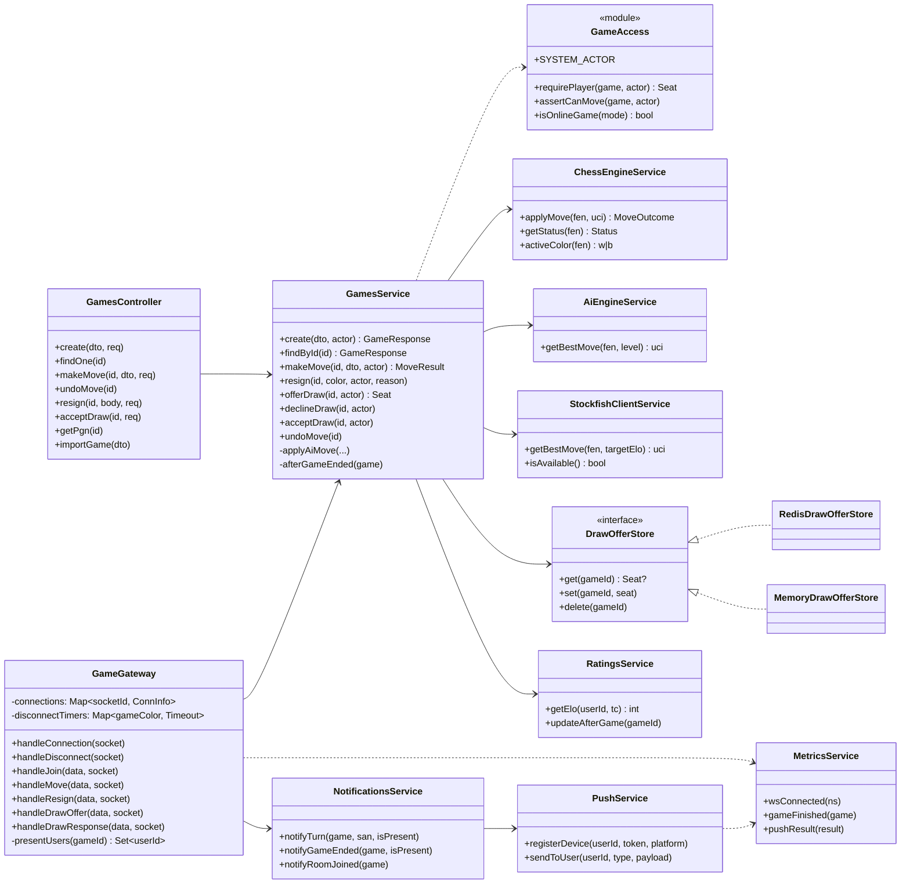

### 2.4 Diagramme de classes — comptes, matchmaking, lobby

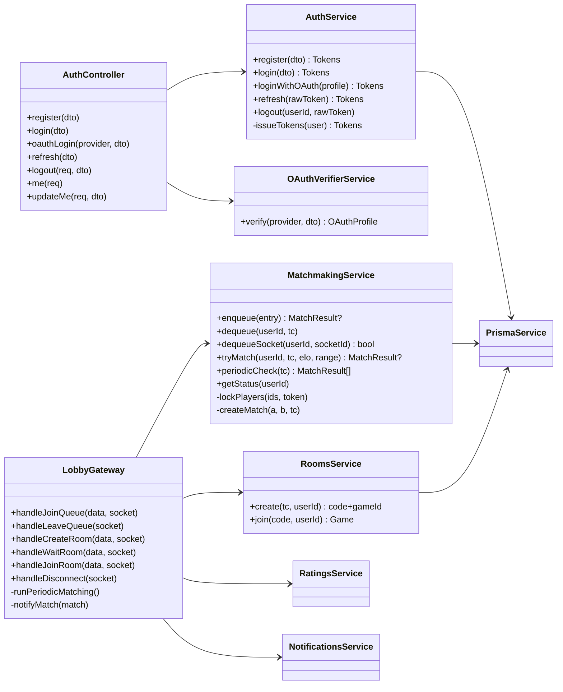

---

## 3. Diagrammes de séquence

### 3.1 Connexion et rotation des jetons (sprints 5, 20)

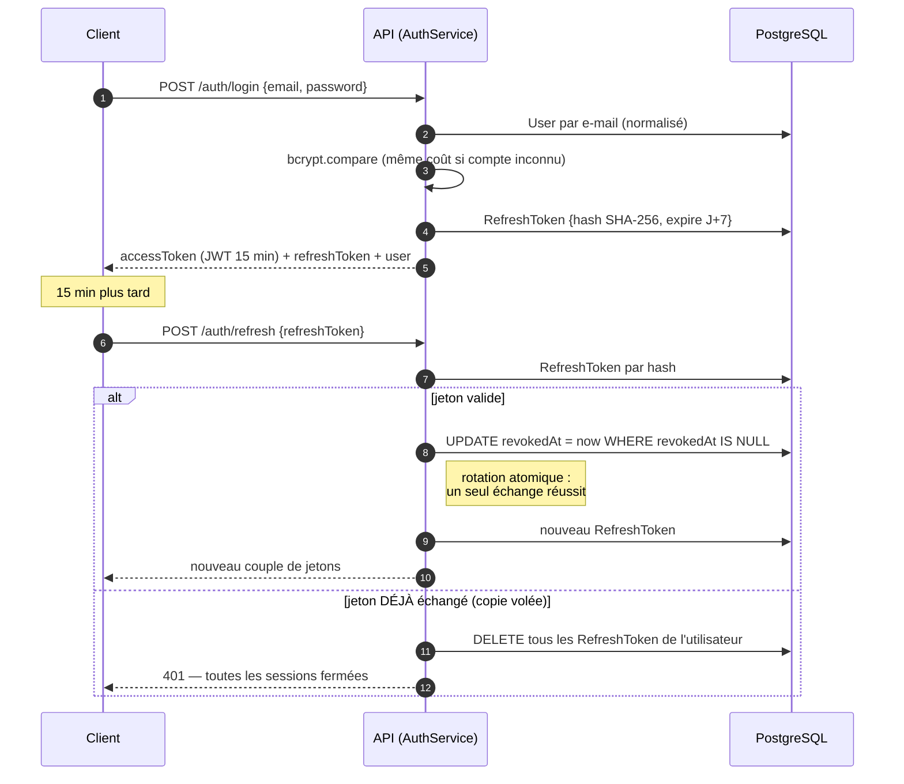

### 3.2 Matchmaking puis partie classée (sprints 7, 17, 19)

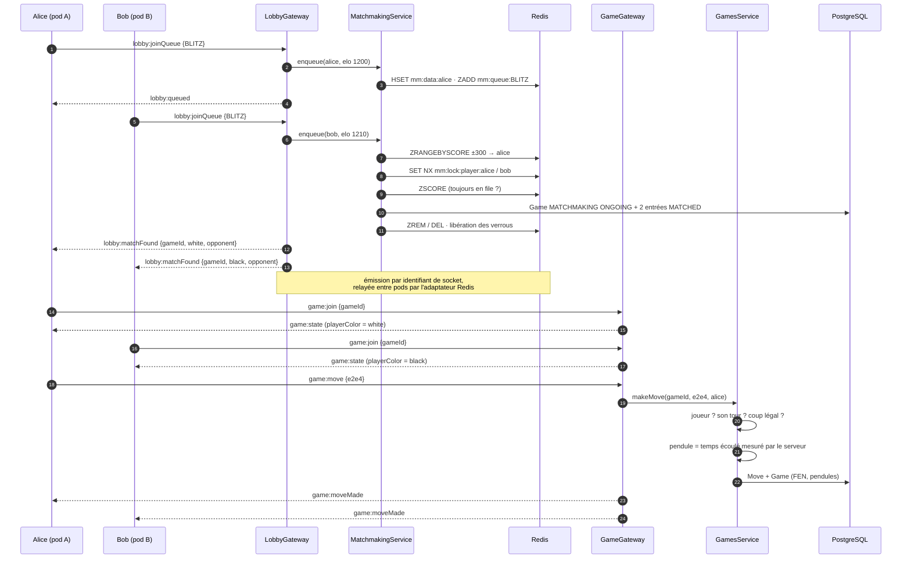

### 3.3 Fin de partie, Elo et notifications

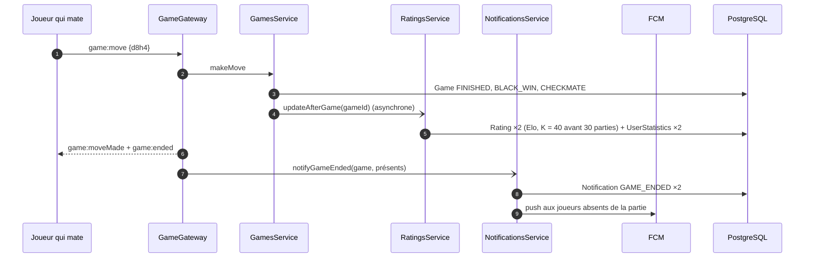

### 3.4 Déconnexion et forfait (sprints 6, 17, 19)

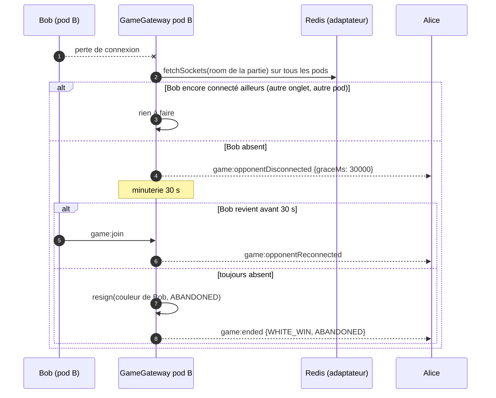

### 3.5 Coup de l'IA

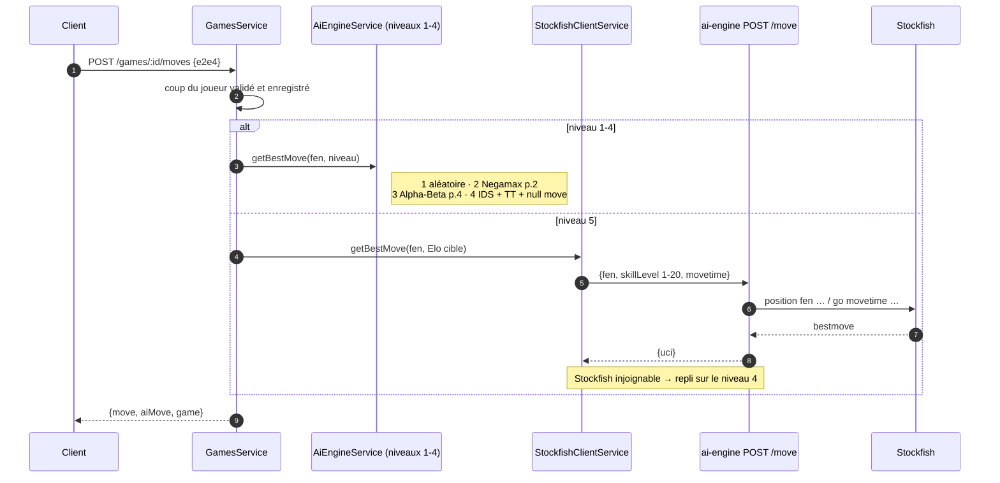

### 3.6 Analyse d'une partie terminée (sprints 8, 18)

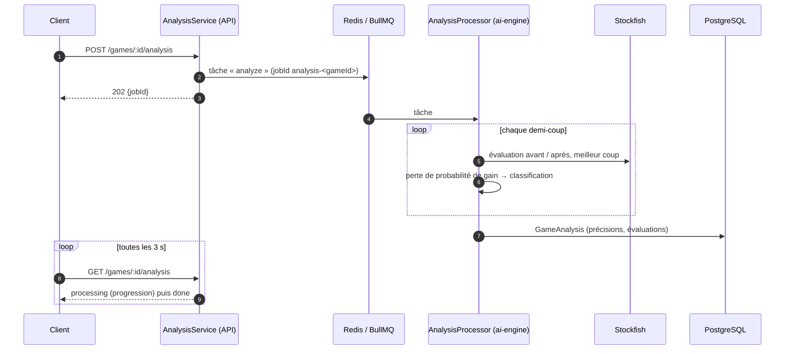

Classification d'un coup selon la **chute de probabilité de gain** du joueur : ≥ 30 points gaffe, ≥ 20 erreur, ≥ 10 imprécision ; sinon « théorie » dans les 8 premiers demi-coups, « meilleur coup » si c'est le coup de Stockfish, « bon » sinon.

---

## 4. Diagramme d'états d'une partie

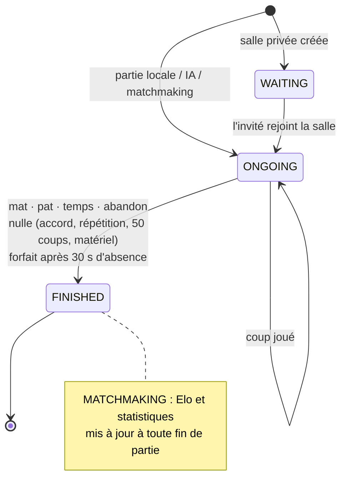

`ABORTED` existe dans le schéma mais n'est attribué par aucun chemin de code aujourd'hui.

---

## 5. Client Flutter

### 5.1 Organisation

```
lib/
├── core/            config (URL, OAuth, Firebase), http (ApiClient), services (SocketService),
│                    settings (réglages + thèmes), theme, widgets communs (avatar, pièce animée)
└── features/        un dossier par fonctionnalité : models / providers / screens / services / widgets
    ├── auth         connexion, inscription, OAuth
    ├── board        plateau, cases, pièces, promotion (BoardPosition, ChessMove)
    ├── game         partie locale et contre l'IA, import FEN / PGN, reprise
    ├── matchmaking  recherche d'adversaire classée
    ├── multiplayer  lobby, salles privées, partie en ligne
    ├── history      « Mes parties »
    ├── replay       lecteur de partie, graphique d'évaluation
    ├── analysis     analyse Stockfish
    ├── leaderboard  classement
    ├── notifications  liste, push FCM
    ├── profile      profil, avatars, statistiques
    ├── settings     réglages
    └── home         accueil
```

### 5.2 État (Riverpod)

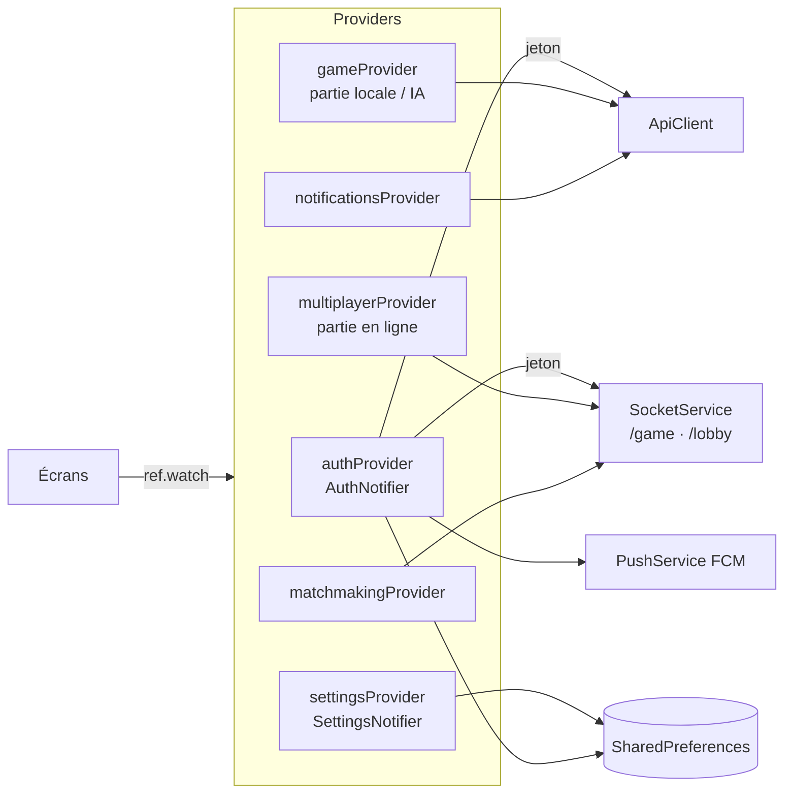

Le jeton d'accès et le refresh token sont stockés dans `SharedPreferences` ; à l'ouverture, `AuthNotifier` restaure la session et renouvelle silencieusement un jeton expiré. Les sockets utilisent exclusivement le transport WebSocket (aucune affinité de session nécessaire côté serveur).

---

## 6. Déploiement

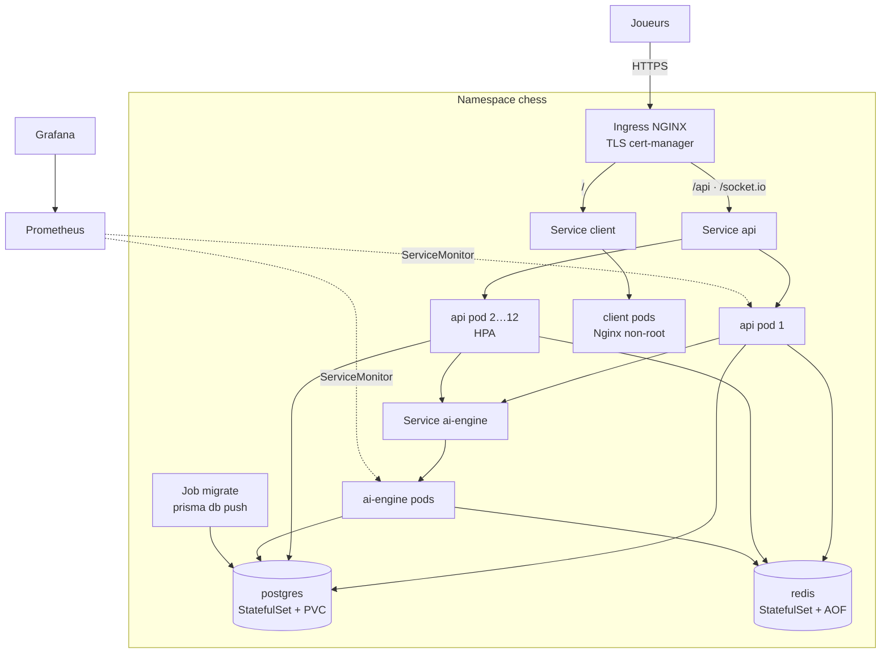

Détails : [docs/deployment.md](deployment.md).

---

## 7. Décisions d'architecture

| Décision | Raison | Conséquence |
|---|---|---|
| Serveur autoritaire (chess.js côté API) | anti-triche de base, une seule source de vérité | le client affiche, le serveur décide ; chaque coup en ligne fait un aller-retour |
| Monolithe modulaire NestJS + microservice IA | Stockfish consomme beaucoup de CPU : on le met à l'échelle séparément | un appel HTTP par coup de niveau 5 ; repli sur le niveau 4 si l'IA est indisponible |
| Socket.IO + adaptateur Redis | temps réel bidirectionnel, plusieurs réplicas | Redis obligatoire en production |
| Présence calculée par `fetchSockets()` | un joueur peut être connecté à un autre pod | une requête inter-pods à chaque déconnexion |
| File de matchmaking dans Redis | atomique, partagée, éphémère | une panne Redis vide la file (sans perte de parties) |
| Refresh tokens hachés, révoqués et non supprimés | détecter la réutilisation d'un jeton volé | lignes conservées jusqu'à expiration (purge à chaque émission) |
| Elo par cadence, K dégressif | classement plus juste entre bullet et classique | quatre classements par joueur |
| `prisma db push` (sans migrations versionnées) | schéma simple, projet jeune | un changement destructeur doit être migré à la main ; passer à `prisma migrate` avant la mise en production durable |
