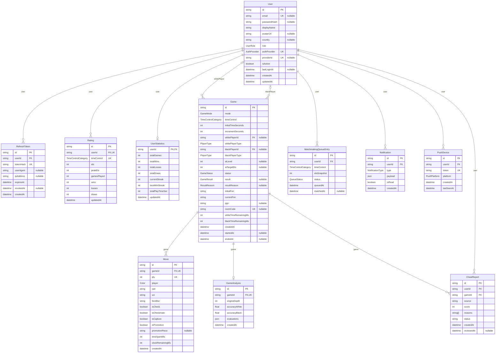

# Base de données de Chess Platform

> Sprint 21 — modèle entité-association, dictionnaire des tables, énumérations, données éphémères de Redis.
> Source de vérité : `apps/api/prisma/schema.prisma` (copie synchronisée dans `apps/ai-engine/prisma/`, vérifiée au build). Le diagramme ci-dessous a été **généré depuis ce schéma**.

SGBD : **PostgreSQL 16**, accès par **Prisma 5**. Le schéma est appliqué par `prisma db push` (Job Helm `migrate`, service Compose `migrate`, ou à la main : `npm run db:push` dans `apps/api`).

---

## 1. Modèle entité-association



Légende : **PK** clé primaire · **FK** clé étrangère · **UK** unicité (seule ou combinée, voir § 2) · `nullable` valeur facultative. Cardinalités Mermaid : `||` exactement un, `|o` zéro ou un, `o{` zéro ou plusieurs.

Toutes les clés primaires sont des **UUID v4** générés par Prisma (sauf `UserStatistics`, dont la clé est l'identifiant du joueur). Les dates sont en UTC, précision milliseconde.

---

## 2. Dictionnaire des tables

### `User` — compte joueur

| Colonne | Type | Règle |
|---|---|---|
| `id` | UUID | PK |
| `email` | texte, unique, facultatif | minuscules (sprint 20) ; absent pour certains comptes Apple / Facebook |
| `passwordHash` | texte, facultatif | bcrypt (10 tours) ; absent pour un compte uniquement OAuth |
| `displayName` | texte | 2 à 32 caractères |
| `avatarUrl` | texte, facultatif | URL `https://` ou préréglage `preset:<pièce>-<couleur>` |
| `country` | texte, facultatif | code ISO 3166-1 alpha-2 |
| `role` | `UserRole` | `PLAYER` par défaut |
| `authProvider` / `providerId` | `AuthProvider` / texte | couple **unique** : un compte Google, Apple ou Facebook ne peut être lié qu'une fois |
| `isActive` | booléen | `false` = connexion et rafraîchissement refusés (un jeton d'accès déjà émis reste valable jusqu'à 15 min) |
| `lastLoginAt`, `createdAt`, `updatedAt` | date | |

Index : `email`.

### `RefreshToken` — sessions

| Colonne | Règle |
|---|---|
| `tokenHash` | **SHA-256** du jeton remis au client (jamais le jeton lui-même), unique |
| `expiresAt` | 7 jours après l'émission |
| `revokedAt` | renseigné à l'échange (rotation). Un jeton révoqué présenté à nouveau = **réutilisation** → toutes les sessions de l'utilisateur sont supprimées (sprint 20) |
| `userAgent`, `ipAddress` | prévus, non renseignés aujourd'hui |

Purge : les jetons expirés d'un utilisateur sont supprimés à chaque nouvelle émission. Suppression en cascade avec le compte.

### `Rating` — classement Elo par cadence

Une ligne par (joueur, cadence) — **unique** `(userId, timeControl)` — créée à la première partie classée de cette cadence.

| Colonne | Règle |
|---|---|
| `elo` | 1200 au départ ; K = 40 (< 30 parties), 20 (< 100), 10 ensuite |
| `peakElo` | meilleur Elo atteint |
| `gamesPlayed`, `wins`, `losses`, `draws` | compteurs de la cadence |

Index : `(timeControl, elo)` pour le classement.

### `UserStatistics` — statistiques globales

Une ligne par joueur (clé = `userId`), mise à jour **à la fin de chaque partie classée** (mode `MATCHMAKING`) par `RatingsService`.

| Colonne | Règle |
|---|---|
| `totalGames`, `totalWins`, `totalLosses`, `totalDraws` | toutes cadences confondues |
| `currentStreak` | victoires consécutives en cours ; une nulle ou une défaite la remet à 0 (sprint 21 : auparavant figée après la 1re partie) |
| `bestWinStreak` | record de victoires consécutives |
| `totalPlayTimeSec` | prévu, non alimenté |

### `Game` — partie

| Colonne | Règle |
|---|---|
| `mode` | `LOCAL` (même appareil), `AI`, `PRIVATE` (salle à code), `MATCHMAKING` (classée) |
| `timeControl`, `initialTimeSeconds`, `incrementSeconds` | cadence ; incrément non utilisé (toujours 0) |
| `whitePlayerId` / `blackPlayerId` | FK facultatives vers `User` : vide pour l'IA, une partie locale anonyme ou une salle en attente |
| `whitePlayerType` / `blackPlayerType` | `HUMAN` ou `AI` |
| `aiLevel` (1-5), `aiTargetElo` (100-3200) | parties contre l'IA |
| `status` | voir le diagramme d'états dans [architecture.md](architecture.md#4-diagramme-détats-dune-partie) |
| `result`, `resultReason` | renseignés à la fin |
| `initialFen`, `currentFen` | position de départ (import FEN) et courante |
| `pgn` | prévu, non renseigné : le PGN est reconstruit à la demande (`GET /games/:id/pgn`) |
| `roomCode` | 6 caractères sans ambiguïté (sans 0/O/1/I), **unique** ; salles privées |
| `whiteTimeRemainingMs`, `blackTimeRemainingMs` | pendules ; en ligne, décomptées par le serveur |
| `createdAt`, `startedAt`, `endedAt` | |

Index : `status`, `roomCode`.

### `Move` — demi-coup

**Unique** `(gameId, ply)` : deux requêtes concurrentes ne peuvent pas enregistrer le même demi-coup.

| Colonne | Règle |
|---|---|
| `ply` | numéro du demi-coup, à partir de 1 |
| `player` | `WHITE` / `BLACK` |
| `san`, `uci` | notation algébrique (`Nf3`) et UCI (`g1f3`, `e7e8q`) |
| `fenAfter` | position après le coup (lecteur, analyse, annulation) |
| `isCheck`, `isCheckmate`, `isCapture`, `isPromotion`, `promotionPiece` | indicateurs |
| `timeSpentMs`, `clockRemainingMs` | temps consommé et pendule restante |

Suppression en cascade avec la partie.

### `GameAnalysis` — analyse Stockfish

Une analyse au plus par partie (`gameId` unique), écrite par le worker de l'IA.

| Colonne | Règle |
|---|---|
| `engineDepth` | profondeur de calcul (15 par défaut) |
| `accuracyWhite`, `accuracyBlack` | précision 0-100 % |
| `evaluations` | JSON, un élément par demi-coup : `ply`, `san`, `uci`, `player`, `evalCp`, `evalWhiteCp`, `bestUci`, `classification` (`book`, `best`, `good`, `inaccuracy`, `mistake`, `blunder`)… |

### `MatchmakingQueueEntry` — historique d'appariement

Trace en base des appariements (`MATCHED`) et des sorties de file (`CANCELLED`). La file d'attente **vivante** est dans Redis (§ 4). Index : `(timeControl, status)`.

### `Notification`

| Colonne | Règle |
|---|---|
| `type` | `GAME_INVITE` (adversaire arrivé dans la salle), `YOUR_TURN`, `GAME_ENDED`, `SYSTEM` |
| `payload` | JSON : `gameId`, `san`, `result`, `reason`, `outcome`… |
| `isRead` | lue / non lue |

Index : `(userId, isRead)` pour le compteur de non-lues.

### `PushDevice` — appareils abonnés aux notifications push

| Colonne | Règle |
|---|---|
| `token` | jeton Firebase Cloud Messaging, **unique** : un appareil partagé appartient au dernier compte connecté |
| `platform` | `ANDROID`, `IOS`, `MACOS`, `WEB` |
| `lastSeenAt` | dernière inscription ; les jetons déclarés invalides par FCM sont supprimés à l'envoi |

### `CheatReport` — signalements anti-triche (novembre 2026)

| Colonne | Règle |
|---|---|
| `source` | `TIMING` (temps de réflexion, API) ou `ACCURACY` (précision Stockfish, moteur IA) |
| `score` | 0–100 ; signalement créé à partir de 50 |
| `reasons` | explications lisibles (ex. « 100 % des coups joués en < 100 ms ») |
| `status` | `OPEN`, `DISMISSED` ou `CONFIRMED` (revue par un administrateur) |
| unicité | (`gameId`, `userId`, `source`) : une ré-analyse met à jour le signalement existant |

---

## 3. Énumérations

| Énumération | Valeurs |
|---|---|
| `AuthProvider` | `LOCAL`, `GOOGLE`, `APPLE`, `FACEBOOK` |
| `UserRole` | `PLAYER`, `ADMIN` (aucun écran d'administration aujourd'hui) |
| `TimeControlCategory` | `BULLET` (1 min), `BLITZ` (5 min), `RAPID` (10 min), `CLASSICAL` (30 min) |
| `PlayerType` | `HUMAN`, `AI` |
| `GameMode` | `LOCAL`, `AI`, `PRIVATE`, `MATCHMAKING` |
| `GameStatus` | `WAITING`, `ONGOING`, `FINISHED`, `ABORTED` (non utilisé) |
| `GameResult` | `WHITE_WIN`, `BLACK_WIN`, `DRAW`, `ABORTED` (non utilisé) |
| `ResultReason` | `CHECKMATE`, `RESIGNATION`, `TIMEOUT`, `DRAW_AGREEMENT`, `STALEMATE`, `THREEFOLD_REPETITION`, `FIFTY_MOVE_RULE`, `INSUFFICIENT_MATERIAL`, `ABANDONED` |
| `Color` | `WHITE`, `BLACK` |
| `NotificationType` | `GAME_INVITE`, `YOUR_TURN`, `GAME_ENDED`, `SYSTEM` |
| `PushPlatform` | `ANDROID`, `IOS`, `MACOS`, `WEB` |
| `QueueStatus` | `WAITING`, `MATCHED`, `CANCELLED` |

Côté TypeScript, ces énumérations sont réexportées par `apps/api/src/common/prisma-enums.ts` depuis `@prisma/client` (une seule définition).

---

## 4. Données éphémères (Redis)

| Clé | Type | Durée | Contenu |
|---|---|---|---|
| `mm:queue:<cadence>` | ensemble trié | — | joueurs en file, score = Elo |
| `mm:data:<userId>` | hachage | 5 min | `socketId`, `elo`, `timeControl`, `queuedAt` |
| `mm:lock:player:<userId>` | chaîne | 10 s | jeton du processus qui apparie ce joueur |
| `chess:draw-offer:<gameId>` | chaîne | 2 h | couleur qui propose la nulle |
| `bull:analysis:*` | BullMQ | jusqu'à 100 tâches terminées / 50 en échec | tâches d'analyse (`analysis-<gameId>`) |
| `chess-socket.io#…` | canaux Pub/Sub | — | diffusion Socket.IO entre pods |

---

## 5. Règles d'intégrité et suppression

| Relation | À la suppression du parent |
|---|---|
| `User` → `RefreshToken`, `Rating`, `UserStatistics`, `Notification`, `PushDevice`, `MatchmakingQueueEntry`, `CheatReport` | **cascade** |
| `User` → `Game` (blancs / noirs) | parties **détachées** (`whitePlayerId` / `blackPlayerId` à `NULL`) par la suppression de compte, avant de supprimer le joueur : l'historique des adversaires est conservé |
| `Game` → `Move`, `GameAnalysis`, `CheatReport` | **cascade** |

Suppression de compte (`DELETE /users/me`, RGPD / Loi 25) : en une transaction, parties en ligne non terminées passées à `ABORTED`, toutes les parties détachées, puis compte supprimé (cascade ci-dessus).

---

## 6. Requêtes utiles

```sql
-- Classement Blitz
SELECT u."displayName", r.elo, r."gamesPlayed"
FROM "Rating" r JOIN "User" u ON u.id = r."userId"
WHERE r."timeControl" = 'BLITZ' ORDER BY r.elo DESC LIMIT 20;

-- Parties en cours par mode
SELECT mode, count(*) FROM "Game" WHERE status = 'ONGOING' GROUP BY mode;

-- Sessions actives d'un joueur
SELECT count(*) FROM "RefreshToken"
WHERE "userId" = '<id>' AND "revokedAt" IS NULL AND "expiresAt" > now();
```
